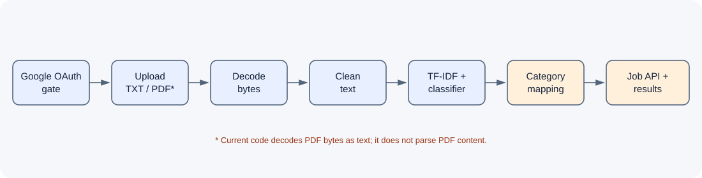
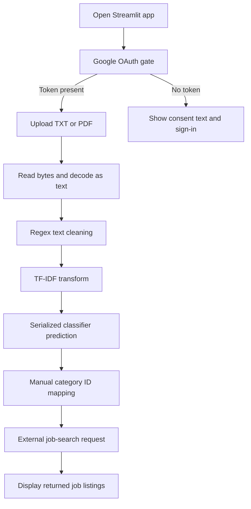
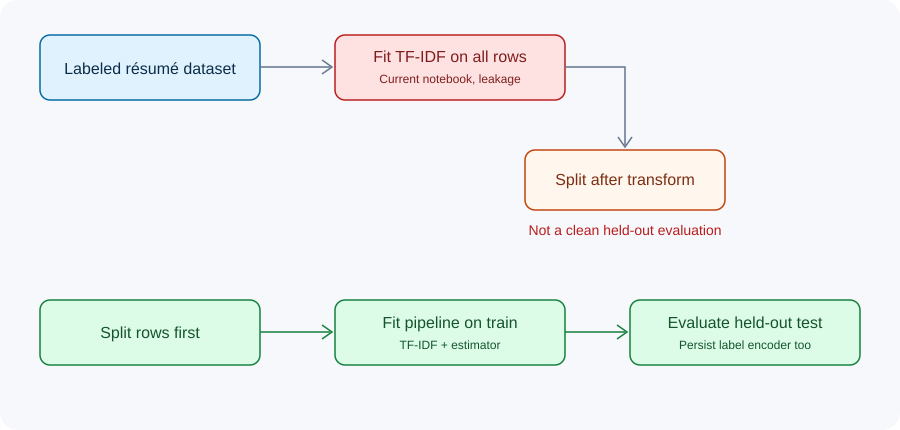

# 🧭 Career Compass

<p align="center">
  
  
  
  
  
  
</p>

<p align="center"><strong>A résumé-text classification and job-discovery prototype built with Streamlit and scikit-learn.</strong></p>

> [!CAUTION]
> **Career Compass is an experimental educational prototype, not a validated career-advice, recruitment, or hiring system.** Do not use its predictions to screen, rank, accept, reject, or select applicants, or to make another consequential decision. Data provenance, consent, redistribution rights, model quality, class mapping, fairness, and privacy controls have not been established.

## 📌 Contents

- [Overview](#-overview)
- [What currently works](#-what-currently-works)
- [How the application works](#-how-the-application-works)
- [Technology](#-technology)
- [Repository layout](#-repository-layout)
- [Quick start](#-quick-start)
- [Configuration](#-configuration)
- [Data and model](#-data-and-model)
- [Security and privacy](#-security-and-privacy)
- [Known limitations and release blockers](#-known-limitations-and-release-blockers)
- [Testing and quality](#-testing-and-quality)
- [Documentation](#-documentation)
- [Contributing](#-contributing)
- [Roadmap](#-roadmap)
- [License and attribution](#-license-and-attribution)

## 🎯 Overview

Career Compass accepts résumé-like text, transforms it with a stored TF-IDF vectorizer, predicts one of 25 job-category labels using a serialized scikit-learn classifier, and requests job listings for the predicted category from an external job-search service.

The repository also contains an exploratory Jupyter notebook, a CSV dataset, serialized model artifacts, a Streamlit interface, and a static HTML/CSS landing page. The implementation is best treated as a learning prototype for text preprocessing, traditional machine learning, Streamlit, OAuth integration, and external API consumption.

### Product boundaries

| Capability | Current repository behavior |
|---|---|
| Sign-in | Google OAuth button using environment variables |
| Resume upload | Streamlit upload control lists TXT and PDF |
| Text extraction | Raw bytes decoded as UTF-8, then Latin-1 fallback |
| Preprocessing | Regex-based cleaning in `clean_resume` |
| Classification | Existing TF-IDF transformer and serialized classifier |
| Job discovery | ScrapingDog LinkedIn jobs endpoint |
| Persistence | No project-owned database or durable user profile store |
| Public API | No project-owned REST or GraphQL API |
| PDF parsing | Not implemented, extension acceptance is not PDF extraction |
| Recommendation quality | Not independently validated |

## ✅ What currently works

The existing code provides a narrow end-to-end demonstration: OAuth-gated interface, upload control, text cleaning, vectorization, one predicted label, and a job-search request. This description is limited to behavior visible in the source. It does not imply production readiness or model validity.

The static `index.html` and `style.css` are a separate landing-page attempt. Their form flow is not a documented registration backend. `session_state.py` is a legacy Streamlit session-state helper and is not imported by the current `app.py`.

## 🔄 How the application works





The flow diagram describes the current code path, including known unsafe or incomplete steps. In particular, the upload path does not parse PDF structure, the category map is not aligned reliably with the notebook's label encoder, and the provider credential requires rotation.

## 🧰 Technology

| Area | Technology visible in repository |
|---|---|
| Application UI | Streamlit |
| Language | Python |
| Text features | scikit-learn TF-IDF |
| Classifier | Serialized scikit-learn estimator |
| Authentication | `streamlit-oauth`, Google OAuth |
| External jobs | Requests, ScrapingDog endpoint |
| NLP resource download | NLTK |
| Data exploration | Jupyter Notebook, pandas and scikit-learn |
| Styling | Streamlit custom HTML/CSS, static CSS |
| Artifacts | Python pickle files |

The complete pinned environment snapshot is in [requirements.txt](requirements.txt). It contains packages beyond those imported directly by the active app. No supported Python version or reproducible artifact-build manifest is currently declared.

## 🗂️ Repository layout

```text
CareerCompass/
├── .github/
│   ├── ISSUE_TEMPLATE/             # Structured issue forms
│   ├── DISCUSSION_TEMPLATE/        # Q&A and idea prompts
│   ├── PULL_REQUEST_TEMPLATE.md
│   └── workflows/                  # CI and documentation checks
├── docs/
│   ├── assets/                     # Architecture and process diagrams
│   ├── decisions/                  # Architecture decision records
│   ├── templates/                  # Reusable project templates
│   ├── architecture.md
│   ├── model-card.md
│   ├── data-governance.md
│   ├── privacy.md
│   ├── security-review.md
│   ├── testing.md
│   └── ...
├── app.py                          # Streamlit application
├── clf.pkl                         # Serialized classifier, trusted source only
├── tfidf.pkl                       # Serialized TF-IDF transformer
├── UpdatedResumeDataSet.csv        # Résumé examples, rights require review
├── Resume Screening with Python.ipynb
├── index.html                      # Static landing page
├── style.css
├── session_state.py                # Legacy helper, currently unused
├── requirements.txt
├── .env.example
├── README.md
├── CHANGELOG.md
├── CODE_OF_CONDUCT.md
├── CONTRIBUTING.md
├── SECURITY.md
├── SUPPORT.md
└── ROADMAP.md
```

See [project structure](docs/project-structure.md) for the role and maintenance status of each component.

## 🚀 Quick start

### Prerequisites

- Git.
- A Python interpreter compatible with the pinned packages in `requirements.txt`. The repository does not currently declare a supported version.
- Network access for package installation and the NLTK download calls made at application startup.
- Google OAuth credentials for the sign-in path. The current redirect URI is hard-coded to the published Streamlit address, so local OAuth needs a corresponding code and provider configuration change.

### Install and launch

**Windows PowerShell**

```powershell
git clone https://github.com/Brajesh31/CareerCompass.git
cd CareerCompass
py -m venv .venv
.venv\Scripts\Activate.ps1
python -m pip install --upgrade pip
python -m pip install -r requirements.txt
streamlit run app.py
```

**macOS / Linux**

```bash
git clone https://github.com/Brajesh31/CareerCompass.git
cd CareerCompass
python3 -m venv .venv
source .venv/bin/activate
python -m pip install --upgrade pip
python -m pip install -r requirements.txt
streamlit run app.py
```

Open the local URL printed by Streamlit, usually `http://localhost:8501`. Stop the server with `Ctrl+C`.

> [!WARNING]
> Do not upload real, confidential, or identifiable résumés. The integration credential is hard-coded in the existing application source and must be revoked or rotated with the provider. Do not use the provider path until the replacement is moved to secure configuration and the app is updated to read it.

Detailed setup: [Installation guide](docs/installation.md).

## ⚙️ Configuration

Copy `.env.example` to `.env` and configure Google OAuth values you control. The file is ignored by Git and must remain private.

| Setting | Current status | Notes |
|---|---|---|
| `GOOGLE_CLIENT_ID` | Read by app | OAuth client identifier |
| `GOOGLE_CLIENT_SECRET` | Read by app | Keep private; use host secret manager |
| ScrapingDog API key | Hard-coded in current app source | Treat as exposed, rotate, then refactor to secret configuration |
| OAuth redirect URI | Hard-coded in `app.py` | Must match the OAuth provider callback |

A placeholder variable in `.env.example` is not proof that application code reads it. See [configuration reference](docs/configuration.md).

## 🧪 Data and model

The notebook loads 962 labeled résumé examples across 25 categories. It applies text cleaning, label encoding, TF-IDF, and classifier experiments before saving serialized artifacts. The application separately maintains a hand-written label mapping.

Important reproducibility and validity concerns:

1. TF-IDF is fitted before the train/test split in the notebook, leaking information from test text into feature construction.
2. The label encoder is not saved alongside the classifier. The app's manual ID-to-name mapping is inconsistent with the notebook ordering for IDs 10–13.
3. The dataset's source, consent basis, provenance, and redistribution license are not documented.
4. Notebook examples may contain personal information and require review before redistribution.
5. The model has no independently reproducible evaluation report, calibration, or fairness assessment.
6. The current cleaner removes broad substrings and non-ASCII characters, which can destroy meaningful résumé content.
7. The serialized pickle files must only be loaded from a trusted origin and compatible Python/scikit-learn environment.



Read the [model card](docs/model-card.md), [data governance guide](docs/data-governance.md), and [model evaluation plan](docs/model-evaluation.md) before proposing model-related changes.

## 🔐 Security and privacy

- **Credential exposure:** a third-party job-search key is embedded in `app.py`. Assume it is compromised, revoke or rotate it, and review Git history. A follow-up commit does not erase previous history.
- **Résumé sensitivity:** uploaded content is processed by the Streamlit server. Job lookup currently uses the predicted category rather than the complete résumé, but hosting logs and retention are not fully specified.
- **Pickle risk:** Python pickle deserialization can execute code. Only use artifacts from trusted sources.
- **Unsafe HTML:** job fields are inserted into HTML in the current interface. Treat external responses as untrusted and render them safely.
- **OAuth limitations:** an OAuth token gate is not a complete authorization, account, or privacy system.
- **Data rights:** the repository license does not grant rights to third-party résumé examples or model artifacts.

See [SECURITY.md](SECURITY.md), [privacy guide](docs/privacy.md), and [security review](docs/security-review.md).

## 🚧 Known limitations and release blockers

| Priority | Issue | Why it matters |
|---|---|---|
| Critical | Hard-coded provider credential in source/history | Exposure and unauthorized use risk |
| Critical | Dataset and notebook data rights undocumented | Privacy and redistribution risk |
| High | Manual class map mismatches encoder for IDs 10–13 | Incorrect category labels |
| High | TF-IDF fitted before train/test split | Evaluation leakage |
| High | PDF accepted but not parsed | Misleading upload behavior |
| High | External response fields inserted into HTML | Potential markup injection |
| High | No timeout on provider request | Hung or slow requests |
| High | No model card or validated metrics | Claims cannot be substantiated |
| Medium | Broad regex cleaning removes useful text | Distorted model input |
| Medium | OAuth callback is hard-coded | Local setup friction |
| Medium | No automated test suite before this enhancement | Regression risk |
| Medium | Python version and artifact manifest absent | Reproduction uncertainty |

The project is not ready for real résumé uploads or public production use. Track improvements in [ROADMAP.md](ROADMAP.md) and the [release-readiness checklist](docs/templates/release-readiness-checklist.md).

## 🧫 Testing and quality

Documentation and workflow checks can validate repository hygiene. They do not validate model correctness, employment suitability, privacy compliance, or provider behavior. The workflow should never report that scientific validity has been established.

For local syntax validation:

```bash
python -m compileall -q app.py session_state.py
```

For the complete validation strategy, use [docs/testing.md](docs/testing.md). Use synthetic résumé text only and mock OAuth/provider network calls in tests.

## 📚 Documentation

| Guide | Purpose |
|---|---|
| [Documentation index](docs/README.md) | Start here |
| [Architecture](docs/architecture.md) | Runtime and component design |
| [Project structure](docs/project-structure.md) | Repository map |
| [Installation](docs/installation.md) | Environment and local startup |
| [Configuration](docs/configuration.md) | Environment and secrets |
| [Development](docs/development.md) | Safe development workflow |
| [Model card](docs/model-card.md) | Intended use, data and model risks |
| [Model evaluation](docs/model-evaluation.md) | Leakage-free evaluation plan |
| [Data governance](docs/data-governance.md) | Provenance, consent and retention |
| [Privacy](docs/privacy.md) | Data-flow and privacy boundaries |
| [Security review](docs/security-review.md) | Threats and mitigations |
| [Dataset card](docs/dataset-card.md) | Dataset rights and provenance gaps |
| [Model training](docs/model-training.md) | Training sequence and artifact lifecycle |
| [Model risk assessment](docs/model-risk-assessment.md) | Model impacts and risk register |
| [Prediction guide](docs/prediction-guide.md) | Cautious interpretation of outputs |
| [External services](docs/external-services.md) | OAuth and provider integration boundaries |
| [Data retention](docs/data-retention.md) | Retention and deletion requirements |
| [Monitoring](docs/monitoring.md) | Privacy-safe operational signals |
| [Backup and recovery](docs/backup-recovery.md) | Source and artifact recovery guidance |
| [UI/UX review](docs/ui-ux-review.md) | Interface gaps and usability checklist |
| [Error handling](docs/error-handling.md) | Error taxonomy and current failure behavior |
| [Dependency management](docs/dependency-management.md) | Package hygiene and compatibility |
| [Quality gates](docs/quality-gates.md) | CI coverage and limitations |
| [Responsible use](docs/responsible-use.md) | Acceptable use and safeguards |
| [User journey](docs/user-journey.md) | Current and proposed user flow |
| [Notebook guide](docs/research-notebook-guide.md) | Safe notebook maintenance |
| [Requirements inventory](docs/requirements-inventory.md) | Existing dependency snapshot |
| [Label taxonomy](docs/label-taxonomy.md) | Current mapping and known class-order issue |
| [Secret rotation](docs/secret-rotation-runbook.md) | Response to exposed provider credentials |
| [Feature scope](docs/feature-scope.md) | Current and absent product capabilities |
| [Testing](docs/testing.md) | Code, integration and model checks |
| [Deployment](docs/deployment.md) | Hosting prerequisites |
| [Operations runbook](docs/operations-runbook.md) | Incident response and shutdown |
| [Accessibility](docs/accessibility.md) | UI accessibility review |
| [Troubleshooting](docs/troubleshooting.md) | Common setup/runtime problems |
| [FAQ](docs/faq.md) | Project questions |
| [Templates](docs/templates/README.md) | Reusable engineering templates |
| [Architecture decisions](docs/decisions/README.md) | Decision records |

## 🏛️ Governance and usage boundaries\n\nRead [GOVERNANCE.md](GOVERNANCE.md) for change review and release responsibility and [DISCLAIMER.md](DISCLAIMER.md) for project use restrictions. The repository also includes a dedicated test harness, repository checker, Dependabot, and CodeQL workflow. See [docs/quality-gates.md](docs/quality-gates.md) for what automation does and does not prove.\n\n## 🤝 Contributing

Contributions should improve clarity, reproducibility, privacy, security, accessibility, and technical reliability. Do not add real résumés, real credentials, personal information, or unsupported claims of model accuracy.

1. Read [CONTRIBUTING.md](CONTRIBUTING.md) and [CODE_OF_CONDUCT.md](CODE_OF_CONDUCT.md).
2. Use synthetic examples and mocked external services.
3. State whether the change affects uploads, personal data, model behavior, or third-party requests.
4. Add focused tests and update the affected documentation.
5. Submit a pull request using the repository template.

## 🗺️ Roadmap

The roadmap prioritizes credential remediation, data rights, correct label mapping, leakage-free training, robust PDF handling, safe rendering, reproducible evaluation, and privacy controls before feature expansion. See [ROADMAP.md](ROADMAP.md).

## 📄 License and attribution

The repository contains an MIT license. That license does not automatically cover the résumé dataset, notebook examples, model artifacts, external images, or third-party resources. Their provenance and redistribution rights must be established separately. See [LICENSE](LICENSE) and [CITATION.cff](CITATION.cff).

---

<p align="center">Built as an educational machine-learning prototype. Treat predictions with caution, protect personal data, and verify every claim.</p>

