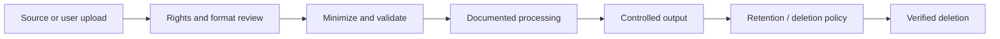

# 🗃️ Data Governance

## Inventory

| Data asset | Observed use | Governance status |
|---|---|---|
| Uploaded TXT/PDF | Decoded and processed by Streamlit | Personal data may be present; retention not fully specified |
| Tracked CSV | Notebook training examples | Source, consent, and redistribution rights undocumented |
| Notebook example | Exploration and demonstration | May contain identifying details; inspect outputs before sharing |
| Model artifacts | Inference in app | Provenance, training manifest, and compatibility details incomplete |
| OAuth token | Session gate | No durable account store documented |
| Job listings | External provider response | Third-party data and provider terms apply |

## Required metadata for any new dataset

Record the provider/owner, original URL or acquisition method, retrieval date, license, consent or lawful basis, population represented, collection purpose, transformations, exclusions, retention, access controls, and checksum/version. If any field is unknown, state that explicitly and do not redistribute until resolved.

## Data minimization

- Use synthetic text for tests, demos, screenshots, and issue reports.
- Do not commit real résumés, names, phone numbers, email addresses, addresses, or employment histories.
- Do not log full uploaded text, OAuth tokens, or provider credentials.
- Retain only fields needed for a documented feature.
- Establish deletion and retention behavior before accepting real users.

## Data lifecycle

This is a governance target, not a statement that every stage is implemented today.

## Review trigger

Any change to upload fields, external API payloads, data storage, training corpus, or logs requires a privacy/security review and update to this document.
