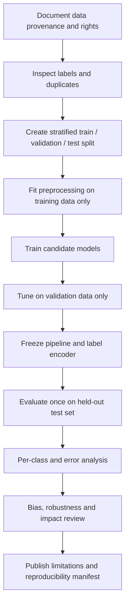

# 📊 Model Evaluation and Reproducibility Plan

## Current state

The notebook performs exploratory model training on 962 labeled examples. It fits TF-IDF before splitting the dataset, which leaks corpus-wide feature information into the evaluation partition. Existing reported scores therefore must not be presented as unbiased generalization performance.

## Required evaluation sequence

## Minimum report

- Dataset version, source, retrieval date, rights and consent basis.
- Row counts, class counts, duplicates and exclusions.
- Exact split strategy, random seed, and grouping rules.
- Preprocessing fitted only within the training pipeline.
- Model family and hyperparameters.
- Accuracy, macro-F1, weighted-F1, per-class precision/recall/F1.
- Confusion matrix and error examples using synthetic or de-identified text only.
- Calibration, abstention, and out-of-distribution behavior.
- Robustness across file formats, spelling, layout, language, and résumé length.
- Limitations, uncertainty, and explicit non-use for employment decisions.

## Leakage controls

1. Split examples before fitting TF-IDF.
2. Use a scikit-learn Pipeline so preprocessing is fit within each training fold.
3. Deduplicate before splitting, and group near-duplicate résumés to avoid cross-partition leakage.
4. Keep final test data untouched until model selection is complete.
5. Save the fitted label encoder as part of the same pipeline artifact.
6. Evaluate on an independently sourced and lawfully usable dataset before any claim of generalization.

## Class mapping integrity

Do not maintain a second hand-written mapping in application code. Derive predicted labels from the persisted encoder or pipeline. Tests must cover every class and verify output order.

## Release gate

No accuracy claim or model release should proceed until data rights, leakage, mapping, reproducibility, and per-class metrics have been reviewed. Passing CI alone is not model validation.
