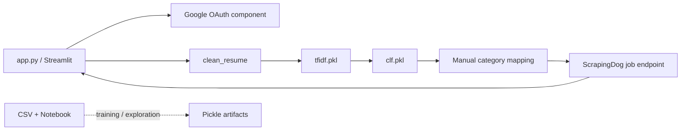

# 🗂️ Project Structure

## Current source map

| Path | Role | Status / notes |
|---|---|---|
| `app.py` | Streamlit UI, OAuth, upload, preprocessing, model inference, job lookup | Active; contains credential and safety blockers |
| `clf.pkl` | Serialized classifier | Trusted artifact only; build provenance absent |
| `tfidf.pkl` | Serialized feature transformer | Must match classifier training pipeline |
| `UpdatedResumeDataSet.csv` | Labeled résumé examples | Rights, consent, provenance undocumented |
| `Resume Screening with Python.ipynb` | Exploration and model training | Contains example personal details; leakage concern |
| `index.html` | Static landing/sign-up page | Not a working account backend |
| `style.css` | Static page styling | Used by landing page |
| `session_state.py` | Legacy Streamlit state helper | Not imported by current app |
| `requirements.txt` | Pinned environment snapshot | Larger than active runtime dependency set |
| `.env.example` | OAuth placeholders | Never put real secrets here |
| `docs/` | Engineering, model, data, operations documentation | Maintained alongside code |
| `.github/` | Templates and automation | Repository contribution/quality controls |

## Runtime dependency view



## Maintenance rules

1. Do not rename or remove model artifacts without updating the load path and tests.
2. Keep a classifier, feature transformer, and label encoder/version information tied to one build.
3. Treat CSV, notebook outputs, and uploads as potentially sensitive until reviewed.
4. Keep generated caches and local secrets out of version control.
5. Update this file whenever the top-level architecture changes.

## Proposed future structure

A future refactor may separate interface, services, model pipeline, schemas, tests, and configuration. That is a proposal, not the current layout:

```text
src/career_compass/
├── ui/              # Streamlit pages and widgets
├── services/        # OAuth and job-provider adapters
├── ml/              # Preprocessing, training, inference, evaluation
├── config/          # Validated configuration
└── domain/          # Typed domain objects and validation
tests/
├── unit/
├── integration/
└── model/
```


## Additional quality infrastructure

```text
.github/
├── DISCUSSION_TEMPLATE/
├── ISSUE_TEMPLATE/
├── workflows/
└── dependabot.yml
scripts/
└── check_repository.py
tests/
├── README.md
└── test_clean_resume.py
docs/
├── assets/                 SVG architecture and process diagrams
├── decisions/              Architecture decision records
├── templates/              Reusable engineering/review templates
└── *.md                   Model, data, operations, security and UX guides
requirements-dev.txt
pytest.ini
GOVERNANCE.md
DISCLAIMER.md
```

The tests extract the pure cleaning function from app.py's syntax tree rather than importing the application and triggering model loading or network downloads. The proposed modular source tree earlier in this document remains a future refactor, not current implementation.


## Quality infrastructure added

```text
.github/
├── DISCUSSION_TEMPLATE/
├── ISSUE_TEMPLATE/
├── workflows/
└── dependabot.yml
scripts/
└── check_repository.py
tests/
├── README.md
└── test_clean_resume.py
requirements-dev.txt
pytest.ini
GOVERNANCE.md
DISCLAIMER.md
```

The unit test extracts the pure text-cleaning helper's AST rather than importing app.py, which would trigger model loading and network-dependent setup. Proposed modular application folders remain future architecture, not implemented source.
