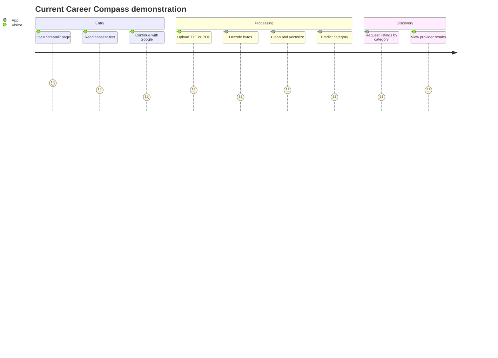

# 🧑‍💻 Current User Journey

## Known journey gaps
The PDF extension is accepted without PDF parsing. No confidence estimate or correction flow is shown. Job search uses a fixed geography identifier and does not compare each listing with résumé content. Provider failures are not distinguished from empty results. Logout, token lifecycle, and deletion flows are incomplete.

## Future-state considerations
A safer design would explain processing before upload, validate file content/size, preview extracted text, make external lookup explicit, communicate uncertainty, distinguish provider errors, and provide an operational deletion/contact process. These are proposals, not implemented features.
